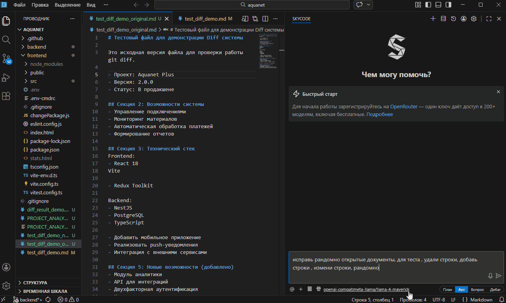

# Skycode AI

> English version: [README.en.md](README.en.md)

**AI-агент для VS Code под ваши модели.**

Skycode AI — расширение VS Code. Оно работает с корпоративным OpenAI-совместимым шлюзом (vLLM, LiteLLM), локальными моделями (Ollama, LM Studio), GigaChat, YandexGPT, OpenRouter и другими провайдерами. Нужен для закрытых сетей и собственных моделей. Без аккаунтов и без телеметрии: запросы уходят только тому провайдеру, которого вы настроили.

<p align="center">
  
</p>

<p align="center">
  <a href="https://ruslansinkevich.ru/skycode/">Сайт</a> ·
  <a href="https://marketplace.visualstudio.com/items?itemName=skycode.skycode-ai">Marketplace</a> ·
  <a href="https://github.com/RuslanSinkevich/skycode/releases">Релизы</a> ·
  <a href="https://habr.com/ru/articles/1096732/">Статья на Хабре</a> ·
  <a href="#документация">Документация</a>
</p>

---

## О репозитории

Репозиторий физически остаётся форком VS Code, поэтому в нём много файлов Microsoft и длинная история коммитов. Продукт лежит только в папке [`extensions/skycode/`](./extensions/skycode). Всё остальное (`src/vs/`, `product.json`, gulp-сборки, `.github/workflows/skycode-release.yml`) относится к прежнему настольному форку Skycode. Он больше не выпускается.

## Установка

Нужен VS Code 1.90 или новее. Идентификатор расширения: `skycode.skycode-ai`.

- Из Marketplace: вкладка «Расширения», поиск «Skycode AI», «Установить».
- Из файла: «Расширения», меню `…`, «Установить из VSIX…». Файл `.vsix` приложен к каждому [релизу на GitHub](https://github.com/RuslanSinkevich/skycode/releases) (теги `ext-vX.Y.Z`).

Если раньше стояло расширение со старым идентификатором `skycode.skycode`, при первом запуске история задач копируется в новое хранилище. Ключи API перенести нельзя, их нужно ввести заново.

## Быстрый старт

1. Откройте панель **Skycode** на боковой панели.
2. Шестерёнка, вкладка **Провайдер**. По умолчанию выбран **OpenAI Compatible**. Остальные провайдеры в разделе «Ещё провайдеры».
3. Укажите адрес шлюза (например `https://llm.company.ru/v1`), ключ API и имя модели.
4. Задайте размер контекста модели и напишите задачу в чат.

## Возможности

### Провайдеры

OpenAI Compatible (по умолчанию), Ollama, LM Studio, LiteLLM, GigaChat, YandexGPT, DeepSeek, Alibaba Qwen, Qwen Code, OpenRouter, Anthropic, OpenAI, Google Gemini, GitHub Copilot (через VS Code LM), Claude Code, OpenAI Codex. Основной сценарий: шлюз с Qwen-подобной моделью.

### Агент и режимы

У агента больше 30 инструментов: чтение и правка файлов, команды в терминале, поиск по коду, `read_symbol`, диагностика, Jupyter, браузер (puppeteer-core), MCP, веб-поиск и загрузка страниц (включаются во вкладке «Веб», по умолчанию выключены).

| Режим | Что делает |
|---|---|
| Акт | Выполняет задачи: правит файлы, запускает команды. Режим по умолчанию |
| Вопрос | Только чтение кода и вопросы. Запись, команды, браузер и MCP заблокированы |
| План | Собирает информацию и предлагает план. Правки откладываются до перехода в Акт |
| Дебаг | Отладка по шагам: сначала факты, потом гипотезы, потом правка. Инструменты те же, что в Акте |
| Чат | Разговор без обращения к проекту. Инструменты только по явной просьбе, запись и команды заблокированы |

Подтверждения для действий настраиваются во вкладке «Разрешения».

### Просмотр изменений

Агент пишет прямо в файлы. Правки остаются непринятыми, пока вы их не примете или не отклоните.

- Добавленные строки подсвечены зелёным фоном на всю строку.
- Удалённые строки показаны тонкой красной чертой на месте удаления. При наведении видно удалённый текст и ссылку «Открыть сравнение».
- Кнопок принять и отклонить в самом редакторе нет.
- Принять текущее изменение: `Ctrl+Shift+Y`. Отклонить: `Ctrl+Shift+N`. Следующее и предыдущее: `Alt+]` и `Alt+[` (на macOS `Cmd+Shift+Y` и `Cmd+Shift+N`).
- «Принять все изменения в файле» и «Отклонить все изменения в файле» есть в палитре команд.
- Над полем ввода чата стоит панель «N файлов +X −Y» со стрелками перехода по изменениям и кнопками «Отменить» и «Принять». Развёрнутая панель показывает файлы; у каждого есть принять и отклонить.
- Клик по файлу в панели открывает стандартное окно сравнения «(до агента ↔ сейчас)».
- Для каждого сообщения сохраняется снимок файлов. Удаление сообщения или повтор откатывают файлы к состоянию до него.

Подробности: [Просмотр изменений](./docs/skycode/systems/diff-system.md).

### Экономия контекста

Рассчитано на модели с контекстом около 100 тысяч токенов.

- `read_file` читает диапазоны строк. `read_symbol` читает отдельный класс или метод по имени (tree-sitter).
- Повторное чтение неизменившегося файла возвращает короткую заглушку.
- После правки большого файла в ответ идут только изменённые участки, а не весь файл.
- Вывод терминала режется до начала и конца.
- Блок `environment_details` уходит только в изменившихся частях.
- Автосжатие истории включено по умолчанию для всех моделей. Порог по умолчанию: 75% окна.
- Кольцо контекста у поля ввода показывает заполнение по категориям и кнопку «Сжать сессию».

Подробности: [Управление контекстом](./docs/skycode/architecture/context-management.md).

### Устойчивость к сбоям модели

- Если модель повторяет один и тот же текст (в ответе или в рассуждениях, включая длинные короткие узоры), ответ останавливается и модель получает подсказку.
- Оборванный вызов инструмента (файл, правка, команда) не выполняется.
- Для моделей Qwen по умолчанию температура 0,6, `top_p` 0,95, `top_k` 20. Температура 0 заменяется на 0,6.

### Интерфейс

- Задачи во вкладках работают параллельно (не больше трёх запросов к модели одновременно). Остальные ждут в очереди.
- Пока агент работает, новые сообщения встают в очередь. `Enter` в пустом поле отправляет верхнее сообщение очереди и прерывает агента.
- Схемы Mermaid, графики и таблицы (`show_chart`) и статичные визуализации (`show_visual`) отображаются в чате.
- Длинные строки в таблицах и блоках кода переносятся.

### Поиск по коду

`codebase_search` работает без индексации: карта репозитория (объявления через tree-sitter) и ripgrep. Векторный индекс необязателен и по умолчанию выключен. Рабочий режим `remote` подключает любой OpenAI-совместимый embeddings API. Режим `local` в сборке из Marketplace недоступен. См. [Индексация](./docs/skycode/systems/indexing-system.md).

### MCP

Подключение серверов по Model Context Protocol: `stdio`, SSE и Streamable HTTP. Вызовы инструментов MCP по умолчанию требуют подтверждения. См. [MCP](./docs/skycode/systems/mcp.md).

### Голосовой ввод

Для русского языка используется GigaAM v3 с пунктуацией на sherpa-onnx. Текст появляется во время речи. Распознавание локальное. Один раз нужно скачать около 230 МБ во вкладке настроек «Голос». Для других языков используется whisper.cpp. См. [Голосовой ввод](./docs/skycode/systems/voice-input.md).

## Разработка

Работа идёт в `extensions/skycode`. Сборку VS Code целиком запускать не нужно.

```bash
cd extensions/skycode
npm ci
cd webview-ui && npm ci && cd ..
npm run protos
npm run package
```

Проверки, упаковка и релиз описаны в [CONTRIBUTING.md](./CONTRIBUTING.md) и [руководстве по разработке](./docs/skycode/development/getting-started.md).

## Документация

Английские версии лежат в [docs/skycode/en/](./docs/skycode/en/architecture/overview.md).

### Архитектура
- [Обзор архитектуры](./docs/skycode/architecture/overview.md)
- [Модуль Core](./docs/skycode/architecture/core.md)
- [Управление контекстом](./docs/skycode/architecture/context-management.md)

### Системы
- [Просмотр изменений](./docs/skycode/systems/diff-system.md)
- [Голосовой ввод](./docs/skycode/systems/voice-input.md)
- [Индексация кодовой базы](./docs/skycode/systems/indexing-system.md)
- [Интеграция MCP](./docs/skycode/systems/mcp.md)

### Разработка
- [Руководство по разработке](./docs/skycode/development/getting-started.md)
- [Добавление инструментов агента](./docs/skycode/development/adding-tools.md)
- [Добавление настроек](./docs/skycode/development/adding-settings.md)
- [Сетевые запросы и прокси](./docs/skycode/development/network.md)

Вопросы безопасности: [SECURITY.md](./SECURITY.md).

## Поддержать проект

[CloudTips](https://pay.cloudtips.ru/p/3a95e808) · [Boosty](https://boosty.to/skycodeai) · автор в Telegram: [@ruslansinkevich](https://t.me/ruslansinkevich)

## Благодарности

Skycode использует идеи и код открытых агентов [Cline](https://github.com/cline/cline), [Kilo Code](https://github.com/Kilo-Org/kilocode) и [Continue](https://github.com/continuedev/continue) (Apache-2.0). Полный список: [THIRD_PARTY_NOTICES.md](./THIRD_PARTY_NOTICES.md).

## Лицензия

[Apache License 2.0](./LICENSE)
